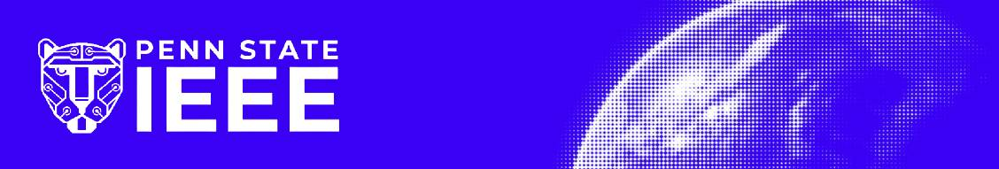

We are the official Penn State student branch of the **Institute of Electrical and Electronics Engineers**, and a leading EECS organization at Penn State. We grow technical and professional skills, connect members with employers, and build community across EE, CMPEN, CMPSC, and anyone interested in EECS.

Our work is organized around four pillars: **Corporate**, **Technical**, **Outreach**, and **Social**. The code you'll find here lives under the Technical Pillar, built by members, for members.

### 🔧 Active Projects

Long-term, member-led engineering projects developed through the Technical Pillar:

- [Business Cards](https://github.com/psuieee/business-cards) - A custom business card project covering schematic design, PCB layout, programming, and final assembly.

### 🛠️ Active Workshops

Hands-on workshops teaching practical skills not typically covered in the classroom:

- [Poket Pomodoro](https://github.com/psuieee/PoketPomodoro) - Build your own handheld productivity timer designed to help people use the pomodoro method and ace their exams!
---

🔗 Learn more at [pennstateieee.org](https://pennstateieee.org) · [LinkedIn](https://www.linkedin.com/company/official-penn-state-ieee) · [Discord](https://discord.gg/6HeuT2vkv3) · [Instagram](https://www.instagram.com/psu_ieee/)